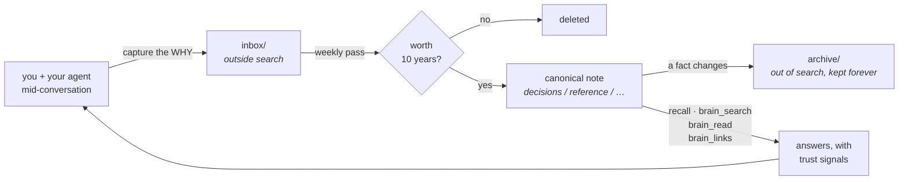
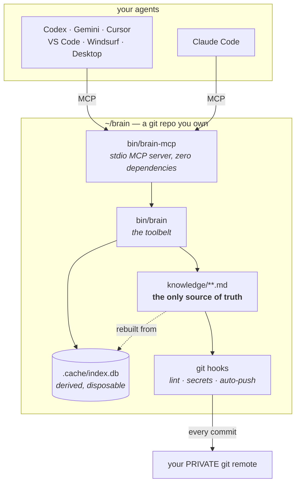

<!-- Replace with docs/assets/hero-*.svg once generated — see docs/assets/BRIEFS.md (B2) -->
<h1>brain</h1>

**A second brain that stays true.** Your knowledge as plain markdown in a git
repo you own, wired so any MCP-capable agent can search it, read it, and add to
it — and built to stay *accurate* as it gets large, not just to get large.

Works with Claude Code, OpenAI Codex CLI, Gemini CLI, Cursor, VS Code + Copilot,
Windsurf, and Claude Desktop. macOS, Linux and Windows.

---

## The problem this exists for

<!-- Replace with docs/assets/concept-decay-*.svg once generated — BRIEFS.md (B4) -->

Note-taking systems do not fail by losing notes. They fail by **filling up**.
Year one, everything in there is true and you trust all of it. Year three, most
of it is stale, some of it is wrong, and nothing about a note tells you which
kind you are reading. So you stop trusting the pile, and a system you do not
trust is one you stop consulting — which is the same as not having it.

Handing that pile to an AI makes it worse, not better: the model answers
confidently from whichever note it happened to retrieve, including the one you
superseded eighteen months ago.

So most of this system is not storage. It is machinery for keeping knowledge
true as it grows.

## The loop



The capture step is the one people skip, and it is the one that matters. The
*what* is recoverable from git, files and calendars. The **why** — the
alternative you rejected, the constraint you discovered, the root cause that
cost you a day — evaporates within a week. That is what this captures.

## How it is put together



Two properties do most of the work. **The markdown files are the only truth** —
every index is derived and can be deleted at any time. And **the tool layer is
vendor-neutral**: `bin/brain-mcp` is a stdio MCP server with no vendor SDK, so
switching models or agents loses nothing.

## Install

Two commands. The first gives you a working, backed-up brain; the second lets
your agents reach it. Each ends in a working state, so stopping after either
one is a legitimate place to stop.

**macOS and Linux**

```sh
curl -fsSL https://raw.githubusercontent.com/Cazy00/brain/main/install.sh | sh
```

**Windows** (PowerShell)

```powershell
irm https://raw.githubusercontent.com/Cazy00/brain/main/install.ps1 | iex
```

Both do the same thing: check git and Python, fetch the template, and hand off
to `brain setup`, which asks where the brain should live, gives it a git history
that is **yours**, creates your **private** GitHub repo, and proves the result
with `doctor`. Setup's exit code is doctor's, so an install it calls done is one
the health check agrees with. Prefer to read it first? It is
[one file](install.sh), and under 120 lines.

Then, from the new brain:

```sh
brain connect                     # what this machine is wired to
brain connect --all --apply       # register the server with every client found
brain connect --routing --apply   # the rule that makes agents reach for it
```

Only using this on one computer? That is everything. Reaching it from other
devices is a separate, optional step — `brain serve`, and
[SETUP.md](SETUP.md) Part 8.

### Prerequisites

Nothing is ever installed for you. Setup prints the exact command and what you
lose by skipping it.

| | | Without it |
|---|---|---|
| `git` | **required** | Nothing works — the brain *is* a git repository |
| `python3` ≥ 3.9 | **required** | The toolbelt and the MCP server are Python |
| `gh` | optional | No automatic private backup; you create the GitHub repo yourself |
| `gitleaks` | optional | The secret gate falls back to the built-in scanner alone |
| `age` | optional | No encrypted vault for sensitive notes |
| `rg` | optional | Search still works; the plain-grep tier is slower |

### Handing this to an agent

The whole install is scriptable, and setup speaks JSON for exactly this reason:

> Install the brain from https://github.com/Cazy00/brain — run its install
> script, then `bin/brain setup --json --yes`, then `bin/brain connect --all
> --apply` and `bin/brain connect --routing --apply`. Report the JSON.

**Claude Code users** can also install the plugin:

```
/plugin marketplace add Cazy00/brain
/plugin install brain@cazy00
```

The plugin is wiring only — it registers the MCP server and ships the `/brain`
skill, pointing at whatever brain repo you already have. Your notes never live
in the plugin directory.

Full guide, including schedules, the encrypted vault and a second machine:
**[SETUP.md](SETUP.md)**. The rules notes are held to: **[AGENTS.md](AGENTS.md)**.

## The memory verbs

Since 0.5.0 the brain also speaks four verbs besides the three tools above:
`recall` (search, plus saved facts), `remember` (save one fact, with the source it
came from), `forget` (retract a saved fact) and `delta` (what changed since a
moment, paged by a cursor). They are the memory protocol MEMORY_VERBS v1 of
[garrytan/gbrain](https://github.com/garrytan/gbrain) (MIT, pinned to commit
`fd22a75`), without its `entity`, `context_pack` and `synthesize`, which this
brain answers as `unavailable` and never lists. The interface is written down as
the contract **`brain-verbs.v1`**: a document and a machine-readable schema file,
`docs/contracts/brain-verbs.v1.md` and `.json`, kept in the owner's private
workspace repository (it is not in this one). The engine's side of the bargain is
tested here: `tests/test_memory_verbs_conformance.py` runs gbrain's 24 conformance
cases (vendored under `tests/fixtures/memory-verbs/`, with their licence) — 16 apply,
and the 8 that do not are replaced by a check that the three verbs are unlisted and
unavailable — and `tests/test_golden.py` holds the output of `brain_search`,
`brain_recent` and `brain_capture` byte for byte against 0.4.5, because they stay
served, unchanged, until every client has moved. They retire in 1.0.0.

What differs from gbrain, on purpose: a plain `recall` query returns no facts (a
fact is an unconsolidated capture, and an inbox note is met only by asking for it,
with `entity` or `scope: "all"`); `forget` takes fact ids only; `remember` refuses a
credential, a line break or a bad label in `provenance` and `entity` before anything
reaches git. `initialize` carries `_meta["brain-verbs"]` saying which verbs an
endpoint serves; the read-only endpoint serves `recall`, `delta`, `brain_search`,
`brain_read`, `brain_links` and `brain_recent`.

Three rules the verbs add, each held by a test:

- **Private means private to a remote caller.** A fact saved with
  `visibility: private` never appears over a remote transport in any form: not in
  `recall` (facts or pages), not in `delta` (pages or facts), and `brain_search`,
  `brain_recent`, `brain_read` and `brain_links` answer as if the capture did not exist.
  The retraction `forget` writes for a private fact is private too.
- **`forget` retracts one capture, and trusts itself for nothing else.** Its
  retraction carries a `retracts:` key naming the one inbox capture it removes. The
  consolidation pass accepts a drained pair of capture and retraction on that key alone;
  it never lets a `forget` retract a note under `knowledge/`, and the owner's own
  `Retract` correction (`source: local`, `basis: owner-said`) works as before. A forgotten
  fact leaves the facts arm, the pages arm of `recall` and the `delta` walk at once.
- **`delta` pages are authoritative.** The cursor orders facts by `captured_at`. A
  capture synced in from another machine with a `captured_at` earlier than a cursor you
  already hold appears in `pages` (by file time) but may never appear in `facts`. Read
  `pages` to be sure nothing is missed.

A `brain:write` OAuth token opens `brain_capture` only; `remember` and `forget` need
`brain:read` as well, because they answer (a duplicate returns the stored path, a forget
tells a missing id from an expired one).

## Search by meaning (optional, off by default)

Keyword search stays the default and the truth. Beside it the engine can rank by
meaning, from **derived** vectors, and fuse the two lists. It is stdlib-only: the
engine ships no model and no server, only a client for an embedder you run.

**Point it at an embedder.** Any server that answers the OpenAI-shaped
`POST {BRAIN_EMBEDDER_URL}/v1/embeddings` works (llama.cpp's `llama-server
--embeddings` with `Qwen3-Embedding-0.6B` is the intended one; `nomic-embed-text-v1.5` also works). It should be
reachable only from the brain's host, because note text is sent to it. The engine
sends the model's task prefixes (a built-in table by model name: Qwen3's `Instruct: ...\nQuery:` before a query and nothing before a document; nomic's `search_query: ` and
`search_document: `; none for a model not in the table; `BRAIN_EMBEDDER_QUERY_PREFIX` and
`BRAIN_EMBEDDER_DOC_PREFIX` override either, `\n` meaning a newline), uses no proxy and follows no redirect.

| Setting (environment) | Meaning |
|---|---|
| `BRAIN_VECTORS` | `off` (default), `shadow` or `on`. `shadow` builds nothing by itself but serves hybrid to `recall` calls that pass `mode: "hybrid"`; `on` makes hybrid `recall`'s default. `brain_search` is keyword-only in every mode. Anything else counts as `off`. |
| `BRAIN_EMBEDDER_URL` | Base URL of the embedder (`http` or `https`). |
| `BRAIN_EMBEDDER_MODEL` | Model name, sent to the embedder and stored as each vector's `model_key` (default `qwen3-embedding-0.6b`). A new name makes every stored vector stale. |
| `BRAIN_VECTOR_FLOOR` | A chunk counts only if its cosine is above this (default 0.53, calibrated for the pinned model; calibrate on your own notes). |
| `BRAIN_VECTOR_HIGH` | A vector-only hit at or above this is `high_vector_match`, below it `weak_semantic` (default 0.71, calibrated for the pinned model). |

**Build the vectors:** `brain index --vectors` (incremental by content hash, and it
deletes the vectors of notes that left the index) or `--vectors --full` (rebuilds
the file; a failed rebuild leaves the old one serving). It embeds exactly the notes FTS
indexes, never `archive/`, `vault/`, `attachments/` or `handoff/`. The file,
`vectors.db`, sits in the state directory next to `index.db`, is never backed up and
may be deleted at any time. A note is embedded as its title, aliases and topics plus
body chunks of about 1,500 characters cut at paragraph breaks, each led by the title,
and scores by its best chunk plus a tenth of its second best. Running it after a pull or on a timer is a deployment concern: the shipped
`deploy/` (below the engine, for a VPS) wires it. With `--quiet`, the form the timers
use, `BRAIN_VECTORS=off` or an embedder that is down is one warning on stderr and exit
0 instead of a failure.

**Deployed (0.6.0).** `deploy/compose.yaml` runs the embedder as its own service:
llama.cpp's server, image and model pinned in `deploy/embedder.env` (multi-arch image
digest; model repository revision, size and sha256), no published port, no egress, on
an internal `embed` network shared only with `brain` and `maintenance`, 1 GiB and 2
CPUs. The model file is fetched by the host into `BRAIN_HOST_MODELS` and mounted
read-only. `BRAIN_VECTORS` in `deploy/.env` defaults to `shadow` there. `brain` does not
wait for the embedder: with it down, everything works and `recall` answers keyword-only.

**What `recall` does with them.** The keyword list is `brain_search`'s ranking; the
vector list is the 10 best notes with a chunk above the floor (cosine times the same folder
weights), brute force in pure Python. The two are fused by reciprocal rank,
`sum 1/(60+rank)`, ties broken by keyword order. A hit in both lists is
`keyword_exact`; a vector-only hit is `high_vector_match` or `weak_semantic`. The
trust rules are the keyword ones: the vector arm only ranks notes the FTS index holds
in a folder the scope allows (inbox and journal only in `scope: "all"`, at weight
0.6), a note whose text changed since its vector was made is served by keyword only,
and every hit carries the same markers. If the embedder is unreachable, takes more than
2 seconds, refuses, or no vectors exist for the model, `recall` answers keyword-only and
sets `search_degraded: "embed_unavailable"`; it never errors.

**Speed.** An MCP server answers `recall` through one long-lived `brain verb-worker`
process (`brainlib/verbworker.py`) instead of starting `brain verb recall` for every call:
the compile, the imports and the read of `vectors.db` are paid once, so a hybrid call is
the query embed plus about 15 ms of arithmetic per 1,000 chunks (Python 3.12+; about
three times that on older Pythons). The worker reads `vectors.db` again whenever the file
changes, restarts when any `BRAIN_*` setting changes, takes the tree lock only for the
length of a call, and any trouble with it falls back to the one-shot command, which gives
the same answer. `BRAIN_VERB_WORKER=off` switches it off. The embedder's speed is the
rest: give `llama-server` as many threads (`-t`) as its CPU quota; more threads than
cores makes every query slower, not faster.

## How it stays true

| Mechanism | What it prevents |
|---|---|
| **Supersede protocol** | Outdated notes get `status: superseded` and physically **move out of the search scope**. Being wrong requires effort, not vigilance. |
| **A commit gate that blocks** | Schema violations, secrets, dangling `[[links]]`, duplicate ids and half-finished supersedes are refused at `git commit`, and again in CI. |
| **Generous capture, strict promotion** | Quick thoughts land in `inbox/`, outside default search. A weekly pass promotes the few that earn it and deletes the rest. |
| **Provenance on every capture** | Each inbox note records when it was captured, the endpoint and client that sent it, and what its writer *claims* it is (`kind`, `basis`). The endpoint stamps what it verified; the caller's claims are weighed as claims, so an agent's inference is never read as your own word. |
| **A validated link graph** | A `[[wikilink]]` to a note that does not exist fails the build. Links rot loudly instead of quietly. |
| **Trust signals on every read** | `[provisional — unconsolidated]`, an ARCHIVED banner, a passed `review_by` — retrieval tells you how much to trust what it just handed you. |
| **`brain stats`** | Measures the things that fail *silently*: findability, capture rate, staleness, curation, orphans. |

## Knowing it still works

`doctor` tells you the machinery is wired. `stats` tells you the **knowledge** is
still healthy — the failures that are silent:

```
$ brain stats

  corpus     412 current note(s)
  capture    6 added in 7d, 31 in 30d, 96 in 90d
  findable   [ok ] 412/412 notes are returned by a search for their own title (100%)
  freshness  180/412 carry a review_by date
  curation   last consolidation: 2026-07-19
```

The headline is **findability**: every note is searched for by its own title and
must come back. It is the weakest query that has to work — if that misses,
nothing you type will do better. `--record` appends a tracked history line, so
the trend survives a re-clone.

`brain connect` answers the other half of the question: not whether the brain is
healthy, but whether your agents are pointed at **this** one. A second clone, or
a brain that moved, leaves an agent talking to a path that is not this one, and
every tool call still succeeds — against nothing.

## Your brain is a git repository

That is the point: permanent, versioned, yours. Two consequences you have to
accept:

- **Every commit auto-pushes.** A hook pushes `main` to your remote in the
  background, through `brain sync --push` — the one code path that pushes, and
  it never pushes anything but `main`. That is the backup, and it makes a lost
  laptop a non-event.
- **So the remote holds everything you ever record — it must be private.**

A brain in a public repo is every private thought you wrote down, world-readable,
in a history that outlives deleting it. So `bin/brain doctor` checks on every run
and fails loudly if your remote is publicly readable:

```
[RED] YOUR BRAIN IS PUBLIC — anyone on the internet can read every note in it.
       Fix it now:  gh repo edit <you>/my-brain --visibility private …
```

GitHub is the default because it is where most people are; any git remote works.
Running with **no remote** is supported — everything works except the backup —
but it is not a state this system will call finished: `doctor` reports it red
every time, and so does `brain setup --no-repo`, on purpose.

## What it deliberately does not do

Listed because a second brain that oversells itself is exactly the kind you stop
trusting.

- **Semantic search is optional and never the truth.** Retrieval is lexical plus
  structure (SQLite FTS5, BM25 over title/aliases/topics/body, folder-weighted,
  plus the link graph). Search by meaning exists only as derived vectors you opt
  into (see above); with `BRAIN_VECTORS` off, the default, the engine is as lexical
  as ever.
- **No contradiction detection between two current notes.** The system fights
  staleness structurally — supersede, `review_by`, link validation — but nothing
  automatically notices that two live notes disagree.
- **One consolidator, pinned.** Any agent can search, read and capture; the
  weekly curation pass runs on exactly one named agent and model. Retrieval is
  deterministic code and identical everywhere, so the only model-dependent
  judgement — what becomes permanent — is not left to whatever happens to be
  running.
- **Client indexes are not trusted.** Several agents ship a semantic codebase
  search that ignores this repo's ignore rules and would return superseded and
  unconsolidated notes as current, stripped of their trust signals. Retrieval
  goes through the brain's own tools.
- **Remote access is opt-in, and takes two kinds of credential.** `brain serve`
  puts the same tools on HTTP behind a token you mint, refuses to start without
  one, binds loopback unless told otherwise, and backs off after repeated failed
  authentication. That covers every client that can set a request header —
  Claude Code, Codex CLI, Cursor, VS Code. `--oauth --public-url <url>` adds an
  OAuth 2.1 authorization server beside it, for **hosted** assistants that never
  see a config file and can only hold a credential a person consented to in a
  browser. It is built to the MCP authorization specification rather than to any
  one vendor — PKCE, protected-resource and authorization-server metadata,
  Client ID Metadata Documents, audience-bound opaque tokens, rotation — so any
  client speaking that spec works, and there is no per-provider code anywhere.
  Both credentials work on the same URL at the same time; the header path is
  unchanged. Dynamic client registration is deliberately absent (the MCP spec
  deprecates it); `serve --new-client` covers anything that needs a client id.
  See [`setup/runbooks/remote-oauth.md`](setup/runbooks/remote-oauth.md), which
  is honest about the two things in it that have not been verified.
  `--read-only` serves the read tools (the four above and the verbs `recall` and
  `delta`) and refuses `brain_capture`, `remember` and `forget`,
  which limits what a holder of the token can *change* — every note is still
  readable. Read-only is a property of the process; a `brain:read` OAuth token
  is the same question asked of one credential rather than one server.
- **The server records what happens, and cannot record what you asked it.**
  `brain logs` shows failed authentication, refused requests, tool errors and
  every step of an OAuth handshake. It holds no query text, no note content and
  no credential — by construction rather than by filtering: the log accepts only
  field names and values from fixed vocabularies, so caller-supplied text cannot
  reach it at all. It lives outside the repository, so it cannot reach git.
- **The privacy rule is instruction-enforced.** "Ask before recording anything
  about a person's private life" is followed by the model, not enforced by code,
  and commits auto-push. Weaker harnesses will eventually get this wrong.
- **Windows is not verified.** CI runs the suite on Linux and macOS only; on
  Windows about 80 tests fail for platform reasons (path separators, file
  locks, bash-only scripts, `os.statvfs`) — see
  `docs/decisions/2026-10-14-windows-ci-informational.md`.
  Nobody on this project owns a Windows machine, so anything CI cannot reach
  there — how the path picker feels in a real terminal, Credential Manager
  prompts — is unverified rather than known to work.
- **A published brain protects the notes you left out of it, and nothing
  else.** `brain publish` compiles a second brain (P) holding only notes a
  human approved, so an agent you do not trust can be pointed at P and there is
  no prompt that gets it the rest — they are not there to get. What it does not
  do: stop a cheap model saying something wrong about what IS in P, or make
  anything in P confidential. Curate P as a public web page, because
  functionally it is one. The isolation is process and credential separation,
  which is why it survives a weak model —
  [`setup/runbooks/business-partition.md`](setup/runbooks/business-partition.md)
  has the checklist that proves it on your own hosts.
- **Not all of it is tested.** The runtime tests cover the toolbelt
  (`python3 -m unittest discover -s tests`, which prints the current count).
  `schedule` and the vault flow are exercised by hand.

## Where things are

| | |
|---|---|
| [SETUP.md](SETUP.md) | The complete guide: install, wiring, schedules, vault, second machine, troubleshooting |
| [AGENTS.md](AGENTS.md) | The protocol: note contract, capture policy, search tiers, supersede |
| [setup/runbooks/business-partition.md](setup/runbooks/business-partition.md) | Two brains: the one you keep, and the one a customer-facing agent may read |
| [docs/assets/BRIEFS.md](docs/assets/BRIEFS.md) | Visual asset specifications |
| `bin/brain --help` | Every command |

## License

MIT — see [LICENSE](LICENSE).
